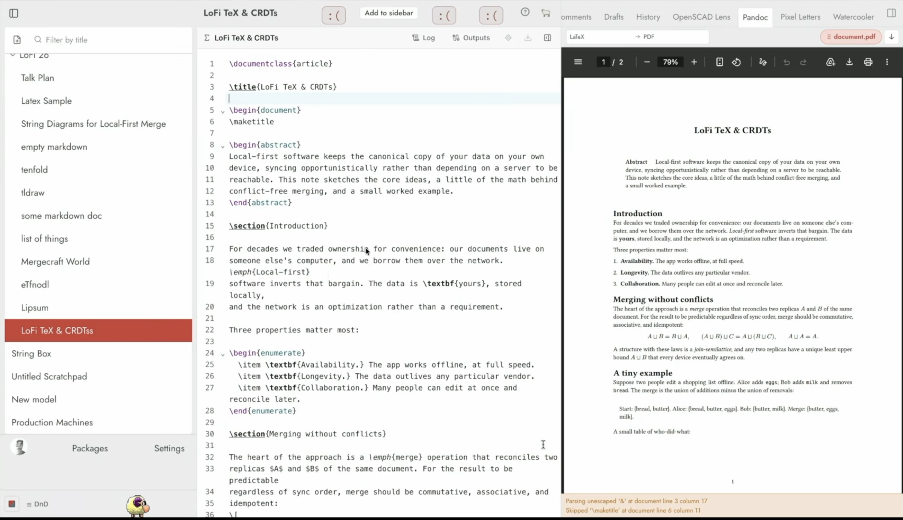
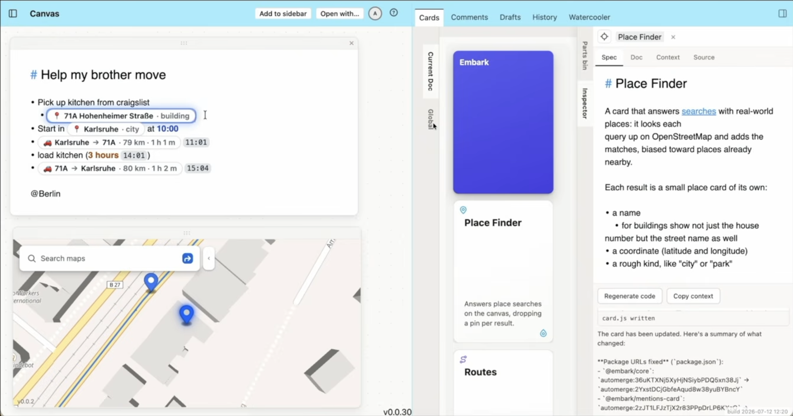
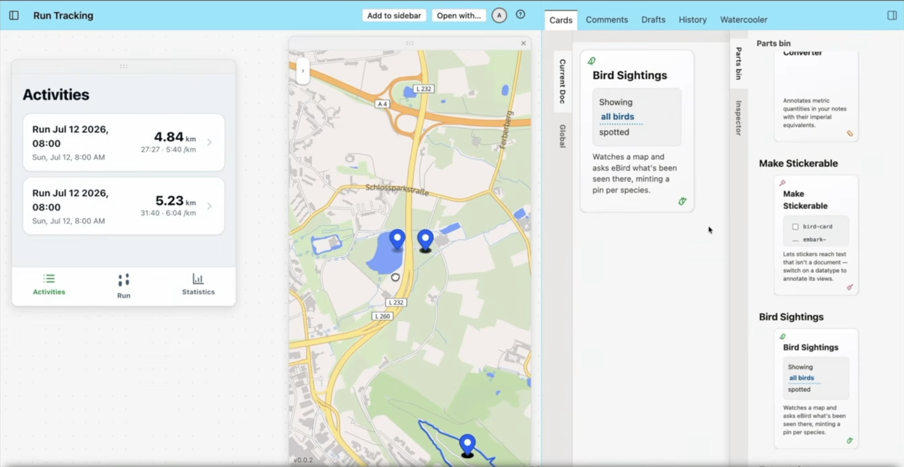
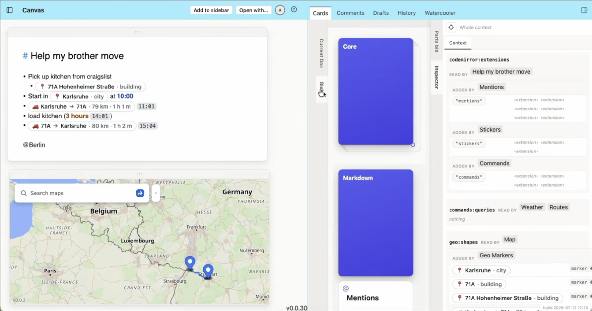

# Patchwork-26 Features demoed but unpublished?

<HUMAN-WRITTEN>

In the talk [Introducing Patchwork-26](https://www.youtube.com/watch?v=4UxGijnuXEs), Ink&Switch demo loads of new features of Patchwork that seem to be absent from the mainline patchwork repo that we've worked with so far.

## Simpler Pandoc converter

For example, in the following image, you can see a pandoc-based document conversion tool that is displayed in the right sidebar instead of in the center. Because of this, it works simiarly to the "Comments" or "Drafts" Panels in that it reacts directly to whatever document you have currently opened in the center pane.

This could be based on [patchwork-experiments/pandoc](/.claude/skills/writing-patchwork-tools/reference/patchwork-experiments/pandoc), but the UI is much simpler because you don't have to select documents, just the output format. Additionally, the new tool has a little drag-and-drop-item of the converted document in the upper right corner that you can drag onto another document to embed it, into the left sidebar to create a new document from it or even out of the browser onto your desktop (at least on macOS, not sure about other OSes) to download it.

## Tools in the right sidebar

However, just the ability to install a tool into the right sidebar currently seems completely absent from the main branch of patchwork. Maybe it is possible and I just don't know any tools that will show up there, or this functionality is on a different branch, or maybe even on a fork of one of the contributors. Either way, this is very powerful functionality that I would like to explore. In the above screenshot you can see that there are more such tools, like "OpenSCAD Lens" and "Pixel Letters".

## Cards, Canvas, Map

One very powerful and frankly revolutionary feature from the demo is "Cards". This is also a tool that installs into the right sidebar, and it allows enriching static documents with dynamic behaviors. In the image below, you can see that a [patchwork-experiments/bullets](/.claude/skills/writing-patchwork-tools/reference/patchwork-experiments/bullets) document is enhanced with an Embark, Place Finder and Routes card, which enable dynamic and reactive route planning based on the locations and times noted down in the bullets document. The specs for this are written in plain language, the actual code is written by an LLM based on that.

You can also see that this bullets document was placed in a "Canvas" editor, something I also haven't seen yet, alongside a Map view, something I **also** haven't seen anywhere else yet.

This project seems to have been developed by the same guy who initially made [Embark](https://www.inkandswitch.com/embark/) (which was only ever a prototype for UX-research, I couldn't find any source code for this), so this entire project might only live on his github repo.

You can also see that Cards, similar to the simple pandoc converter above, lives in the right sidebar, so it always shows the cards for your current document and the inspector for the currently selected card, though you can also switch to a parts bin that (from what I can tell) shows all the cards you've ever used in your account, see the image below.

This also shows another tool called "Run Tracking" which I haven't seen before, though I'm not particularly interested in that one. If we find it, great, if not, no loss.

Cards also has a global tab which contains cards that are active for any document, see below.

</HUMAN-WRITTEN>

## Where the features live

Everything except "OpenSCAD Lens" and "Pixel Letters" is on `main` of [patchwork-base](https://github.com/inkandswitch/patchwork-base) and [patchwork-experiments](https://github.com/inkandswitch/patchwork-experiments) and therefore already in our [vendored snapshot](/.claude/skills/writing-patchwork-tools/reference). The snapshot is identical to upstream `main` (2026-10-12/13) for every path cited here.

| Feature | Location | Author |
| --- | --- | --- |
| Right sidebar ("context sidebar") | [patchwork-base/threepane/src/components/ContextSidebar.tsx](/.claude/skills/writing-patchwork-tools/reference/patchwork-base/threepane/src/components/ContextSidebar.tsx) | chee, Peter van Hardenberg |
| Pandoc in the sidebar | `pandoc-context` in [patchwork-experiments/pandoc/src/index.ts](/.claude/skills/writing-patchwork-tools/reference/patchwork-experiments/pandoc/src/index.ts), UI in [PandocContextTool.tsx](/.claude/skills/writing-patchwork-tools/reference/patchwork-experiments/pandoc/src/components/PandocContextTool.tsx) | Orion Reed |
| Cards (sidebar, stacks, parts bin, inspector) | [patchwork-experiments/cards/core/editors/cards-sidebar](/.claude/skills/writing-patchwork-tools/reference/patchwork-experiments/cards/core/editors/cards-sidebar), individual cards in [cards/cards](/.claude/skills/writing-patchwork-tools/reference/patchwork-experiments/cards/cards) | Paul Sonnentag |
| Spec → code regeneration | [cards/core/editors/inspect](/.claude/skills/writing-patchwork-tools/reference/patchwork-experiments/cards/core/editors/inspect) (`RegeneratePanel.tsx`, `llm/`) | Paul Sonnentag |
| Canvas | `embark-canvas` in [cards/core/editors/canvas](/.claude/skills/writing-patchwork-tools/reference/patchwork-experiments/cards/core/editors/canvas) | Paul Sonnentag |
| Map | `map` in [cards/core/editors/map](/.claude/skills/writing-patchwork-tools/reference/patchwork-experiments/cards/core/editors/map) | Paul Sonnentag |
| Run Tracking | `running-tracker` in [cards/core/editors/running-tracker](/.claude/skills/writing-patchwork-tools/reference/patchwork-experiments/cards/core/editors/running-tracker) | Paul Sonnentag |
| OpenSCAD Lens, Pixel Letters | not on the tip of any branch of either repo (as of 2026-10-14) | |

The whole Cards project is one pnpm workspace named `@tiny-patchwork/embark` (packages `@embark/*`), merged into patchwork-experiments as "Embark+potluck (#21)" on 2026-07-14. It is not in the experiments' [tools bundle](https://patchwork-tools.netlify.app/modules.json), but its core package (every editor above plus the sidebar) is published with pushwork as `automerge:2YxstDCjGbfeAqud8w38yuBYBncY`, the URL the cards depend on as `@embark/core`. The cards themselves are separate packages that a card document loads by URL (`rootUrl` in [parts-bin/catalog.ts](/.claude/skills/writing-patchwork-tools/reference/patchwork-experiments/cards/core/editors/cards-sidebar/src/parts-bin/catalog.ts)).

Installing the core package on patchwork.inkandswitch.com gives Canvas, Map and cards on a canvas, but not the Cards sidebar. The browser served outdated versions of two files: the package's `index.js` from before the sidebar import was added, and a sidebar build importing a chunk that no longer exists. Pushwork pins only some files to a version (the root `index.js` and all of `editors/cards-sidebar/dist/` are linked without heads), and the service worker's resolver (`automerge-protocol-handler-worker.js` in `@inkandswitch/patchwork-bootloader` 0.8.1) pins only the package root: it follows unversioned links with whatever the browser has stored, without catching up with the sync server, and caches the result. Fetching those documents in the tab and clearing the cache made the sidebar work until the next reload. A fresh Node repo always received the current versions, so where the browser's outdated copies came from is unexplained. Its design is described in [cards/spec.md](/.claude/skills/writing-patchwork-tools/reference/patchwork-experiments/cards/spec.md): a page-global store of named JSON channels (`geo:shapes`, `codemirror:extensions`, … as seen in the Global tab's inspector) that any embed reads merged and writes per scope, with a writer's contribution removed when its scope disappears.

### How a tool gets into the right sidebar

The sidebar lists every registered `patchwork:component` carrying the tag `context-tool`, sorted by name; there is no configuration step ([useTaggedComponents.ts](/.claude/skills/writing-patchwork-tools/reference/patchwork-base/threepane/src/hooks/useTaggedComponents.ts)):

> Live, registry-driven list of every `patchwork:component` carrying `tag` (e.g. `"context-tool"` or `"system-tray"`), sorted by name.

A component gets no document handle ([ContextSidebar.tsx](/.claude/skills/writing-patchwork-tools/reference/patchwork-base/threepane/src/components/ContextSidebar.tsx): "always rendered as a bare component with no document"). It finds the focused document itself, either by subscribing to the frame's `patchwork:selected-doc` provider ([pandoc/src/lib/selected-doc.ts](/.claude/skills/writing-patchwork-tools/reference/patchwork-experiments/pandoc/src/lib/selected-doc.ts)) or by listening to `patchwork:open-document` events and the `#doc=` hash ([cards-sidebar/src/selected-doc.ts](/.claude/skills/writing-patchwork-tools/reference/patchwork-experiments/cards/core/editors/cards-sidebar/src/selected-doc.ts)). Comments, Drafts, History and Watercooler (`patchwork-base/chat`) use the same mechanism, which is why the feature looked absent: no tool we had looked at used it.

Until patchwork-base commit `453c19c` ("removing the config for context and sys tray", 2026-07-03) the tabs were instead configured per account (`account.contextToolIds`) and could be `patchwork:tool`s bound to the account document. `pandoc-context` is still registered that way (`type: "patchwork:tool"`, `supportedDatatypes: ["account"]`), so the current frame does not list it. [patchwork-experiments#28](https://github.com/inkandswitch/patchwork-experiments/pull/28) registers it as a `patchwork:component` and moves its per-document settings from the account document, which a component doesn't get, to the frame's `patchwork:tool-storage` provider ([ToolStorageProvider.ts](/.claude/skills/writing-patchwork-tools/reference/patchwork-base/providers/src/ToolStorageProvider.ts): "This gives any tool (in particular ones with no `docUrl` of their own, e.g. a `patchwork:component` context tool […]) a place to persist its own data."). With the PR's deploy preview, the Pandoc tab works on patchwork.inkandswitch.com.

### Tiling frame

[patchwork-experiments/patchwork-frame-tiling](/.claude/skills/writing-patchwork-tools/reference/patchwork-experiments/patchwork-frame-tiling) (Peter van Hardenberg, chee) replaces threepane with freely split panels ([README](/.claude/skills/writing-patchwork-tools/reference/patchwork-experiments/patchwork-frame-tiling/README.md): "Instead of the fixed frame/sideboard metaphor, every document lives in a panel that you can split and resize freely"). Each panel has its own tool picker, and context tools open as panels describing "the most-recently-focused *content* panel" ([screenshot](./09-patchwork-26-features/tiling-frame-tool.png)).

Consequences for the CAD tool:

- A tool can end up in any arrangement (tiles, the context sidebar, separate windows), and tools share nothing but the document. Interaction state such as the error line, the feature being edited or a selection therefore has to stay inside one tool, so the code editor is a pane of the CAD tools, not a separate tool paired with a viewer.
- Several views of the model are useful, several views of the code are not. The viewer tool already works for this: one model in the editor plus two viewers at different angles ([screenshot](./09-patchwork-26-features/tiling-cad-editor-plus-viewer.png)).
- Every viewer runs its own OCCT kernel and evaluates the model separately (each pane reports its own compile, init and build times).

### Corrections to the human-written statements above

- Dragging the converted document onto the desktop is not macOS-specific but Chromium-specific: the drag sets a `DownloadURL` pointing at the file document served by Patchwork's service worker ([PandocContextTool.tsx](/.claude/skills/writing-patchwork-tools/reference/patchwork-experiments/pandoc/src/components/PandocContextTool.tsx): "Chromium-only (`DownloadURL`), but a harmless no-op elsewhere"). Dropping into Patchwork works via the `text/x-patchwork-urls` and `text/x-patchwork-dnd` data types, carrying a freshly created `file` document.
- The parts bin does not show the cards used in the account; it is a hard-coded catalog ([parts-bin/catalog.ts](/.claude/skills/writing-patchwork-tools/reference/patchwork-experiments/cards/core/editors/cards-sidebar/src/parts-bin/catalog.ts): "The parts bin is code-defined: this module *is* the bin. […] nothing about the bin is persisted per browser").
