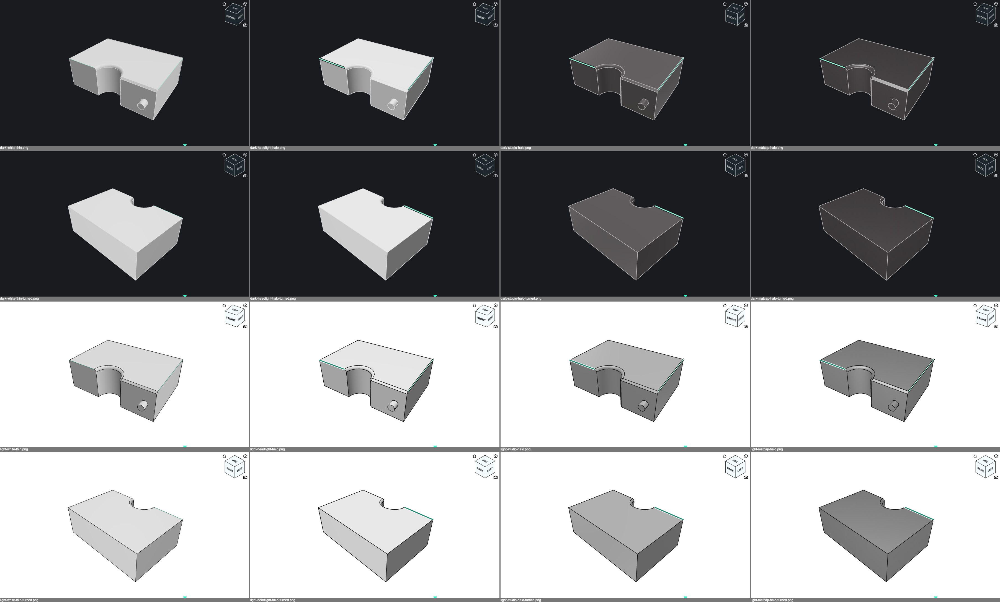
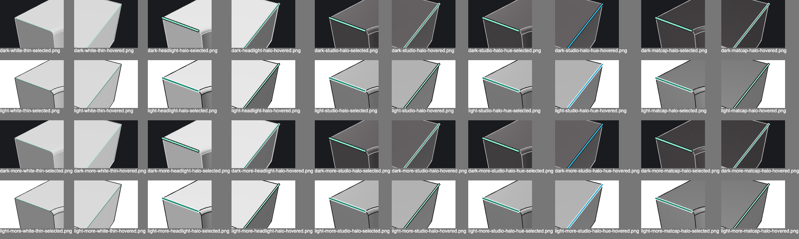
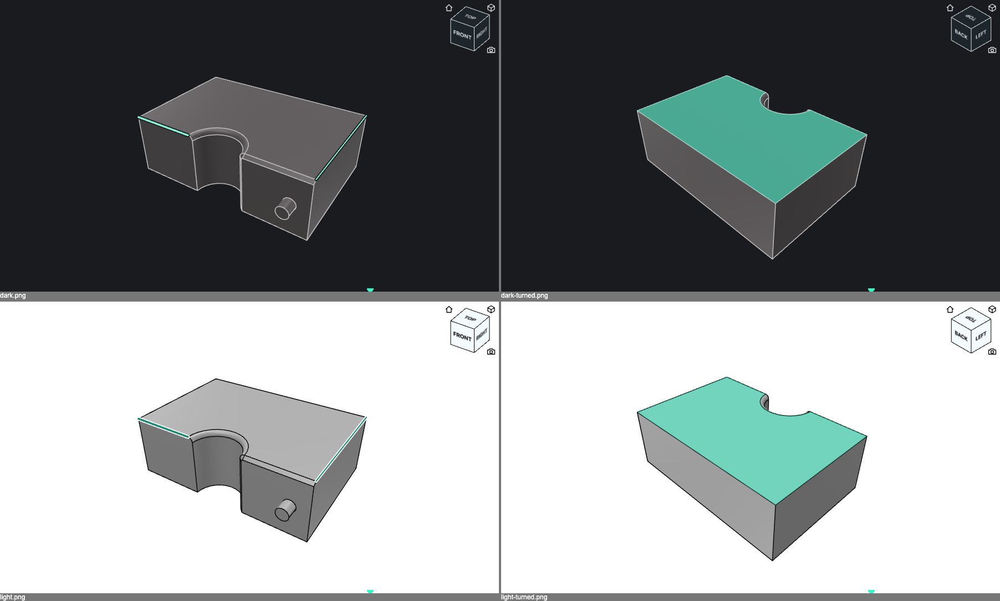
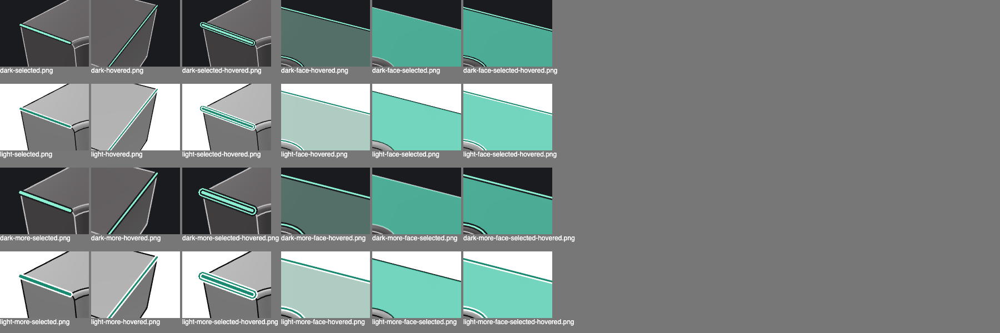
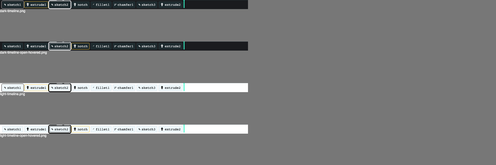

# Edge Contrast

Edges were hard to see in the 3D view: on lit faces, in dark themes, and when highlighted. This document compares ways to render bodies and edges so that edges, hovered and selected ones in particular, read in every theme, and describes the chosen one.

## The problem

The 3D view rendered:

- **White bodies** (`--cad-model-shape: white`) under a hemisphere light and one directional light fixed in the scene. Faces turned to it were pure white, in every theme.
- **1 px edges** in the theme's text colour, white in dark themes, so white on white on lit faces. WebGL can't draw them wider: three.js "WebGL and WebGPU ignore this setting and always render line primitives with a width of one pixel" (`LineBasicMaterial.linewidth`).
- **Hovered and selected edges as the same line** in the accent's text colour; only faces told hover and selection apart. In the timeline, the hovered and the open entry had the same outline.

Fusion, for comparison (the user's screenshots): a mid-grey, slightly reflective body whose shading changes as the camera moves, light edges, and selected edges in two tones, a bright core with a darker sheen around it.

## Variants compared

Screenshots of M1 with the top's front edge selected and its right edge hovered, from the home view and turned to the back left, in light and dark mode, each variant switched in the viewer (the switch is removed since).

| Bodies | |
|---|---|
| white | the white body, fixed lights |
| headlight | the white body, lit by a key light that follows the camera, above and left of it, and a weaker hemisphere light |
| studio | a theme-derived grey, slightly metallic, lit by the headlight and a soft room environment for reflections ([`RoomEnvironment`](https://threejs.org/docs/#examples/en/environments/RoomEnvironment)); edges in the text colour |
| matcap | a `MeshMatcapMaterial` with a sphere shaded from the same grey, which "does not respond to lights since the matcap image file encodes baked lighting" (three.js), so its shading always follows the camera |

| Edges | |
|---|---|
| thin | 1 px lines |
| fat | lines in CSS pixels (`LineSegments2`/`LineMaterial`, whose `linewidth` "Controls line thickness in CSS pixel units"): edges 1.5 px, hovered 2.5 px, selected 3.5 px |
| halo | as fat, each highlight over a wider line in the theme's dark or light ink, whichever contrasts with it |
| halo-hue | as halo, hover in the theme's secondary colour |





- **A white body hides light edges** however it is lit. The headlight changes which faces saturate, not that they do: turned to the back left, every face in view is almost white in dark mode, with fixed light or headlight.
- **A grey body makes plain edges readable** in both modes and from every side. studio also keeps faces apart, top lighter than sides, and its reflections move with the camera, as in Fusion. matcap separates faces less, and its shading, derived from the same grey, makes it too dark in light mode.
- **Wide lines alone don't fix highlights:** a 3.5 px line in the accent colour still vanishes on a face of similar lightness (fat).
- **A halo in the contrasting ink does:** every highlight is a light line on dark or a dark line on light, so one of the two tones contrasts with whatever is behind it: faces, background and other edges, in both modes. A halo in the background colour, tried first, fails for the hover colour, which is the accent mixed towards the background, so core and halo were alike.
- **Hover by weight** must differ a lot: around timeline entries, a 1 px outline next to a 2 px one looked the same.
- **Hover over a selection** must show too: a hover line under or inside the selection's is hidden.
- **Hover by hue** is unmistakable, but the theme has no hue to spare. Every theme defines primary, secondary, danger, warning and link (`--studio-*`); primary marks selections, secondary comments ([13](13-collaboration.md#comments)), warning a feature's dependents, danger errors, and link is another blue. Syntax colours exist only in some themes: in the base theme `--syntax-keyword: var(--text-editor-line)`, and so are the others. Any hue can also be a collaborator's presence colour. So hover differs by weight.

## The rendering

[`Viewer.tsx`](../src/cad/src/components/Viewer.tsx), [`styles.css`](../src/cad/src/styles.css):

- **Bodies** are the studio variant: `--cad-model-shape` is the background mixed with 30 % of the text colour, roughness 0.45, metalness 0.15, under a hemisphere light, a key light above and left of the camera that follows it, and a room environment at intensity 0.35.
- **Edges** are 1.5 px in the text colour, 15 % towards the background (`--cad-model-edge`). Picking still raycasts the 1 px lines, which aren't drawn.
- **One rule for hover and selection:** a selection is a thick line, a hover a thin one, and hovering a selection adds the thin line to the thick one, so both show.
  - **Edges** share the accent's text colour; hover is 2 px, a selection 3.5 px, a collaborator's 3 px in their colour, each over a halo 3.5 px wider in the darker of background and text colour if the line is light (luminance > 0.35), else the lighter. A hovered selection gets a 10 px accent ring in a 13.5 px halo around it.
  - **Faces** keep their fills, hover pale and selection in the accent, and a hover is outlined with the hover's line: the triangle edges of the hovered faces that only one triangle has, by position, so a hovered feature's faces get one outline. A hovered selected face keeps the selection's fill and gets the outline.
  - **Timeline entries:** the open one has a 3 px outline, the hovered or dragged one 1 px, 2 px off it; hovering the open one adds a 1 px line inside it, where the scrolling timeline doesn't clip it.
- **`prefers-contrast: more`** makes every line 1.5 times wider.







[`cad-render-shots.spec.ts`](../src/harness/e2e/tests/cad-render-shots.spec.ts) takes these screenshots:

```sh
CAD_RENDER_SHOTS=<dir> pnpm test:e2e --project=chromium --workers=1 cad-render-shots
```

## Open

- The grey's lightness per mode, e.g. lighter in light mode; with more contrast, a grey further from the background.
- The sketch outline in the view is still a 1 px line.
