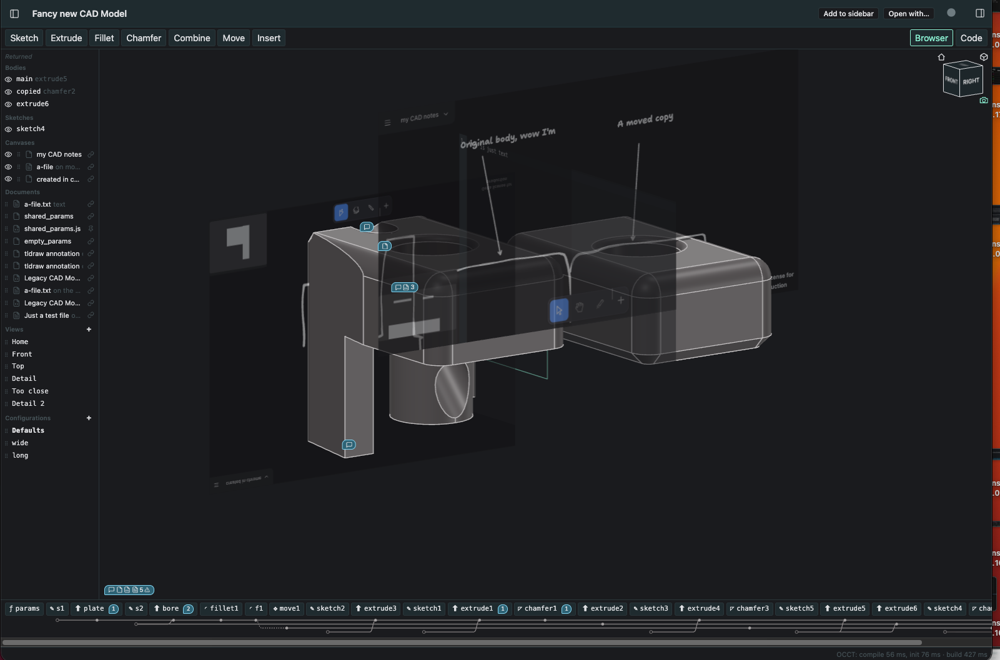
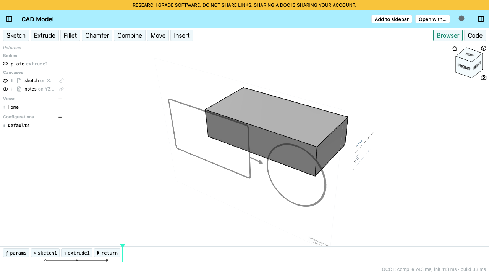
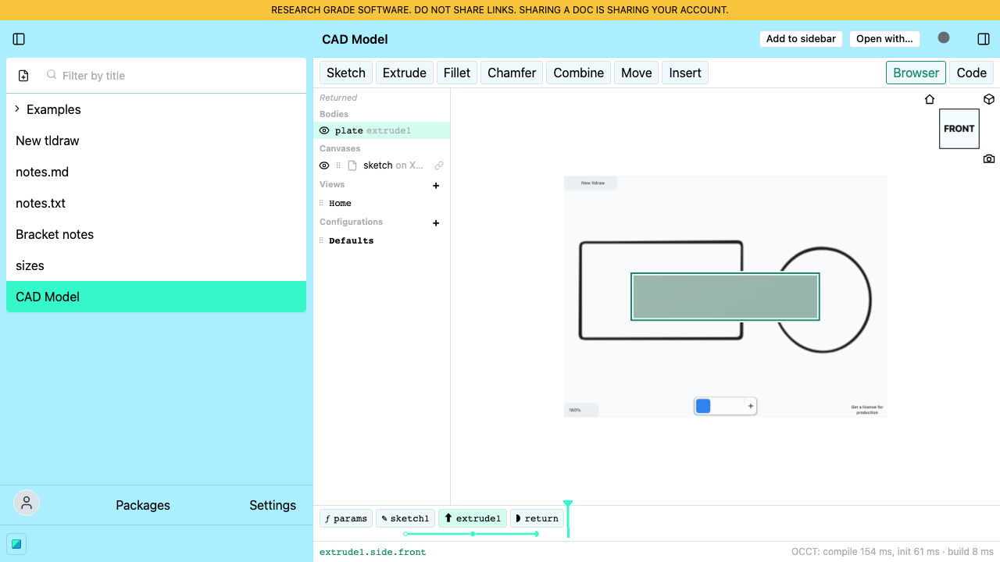
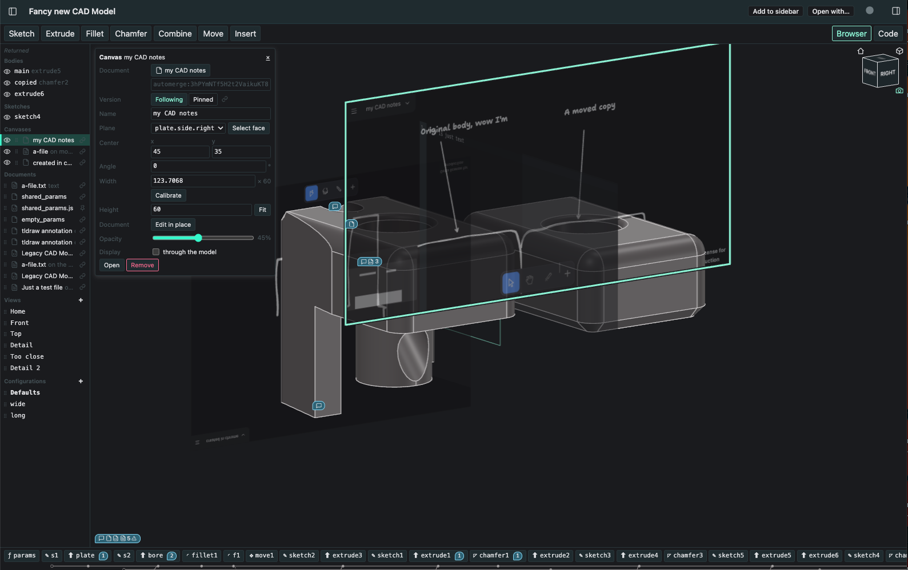
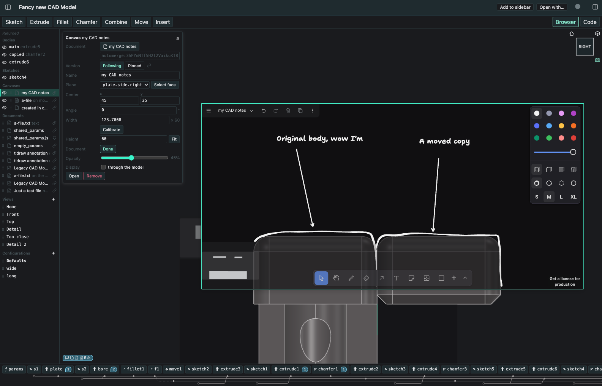
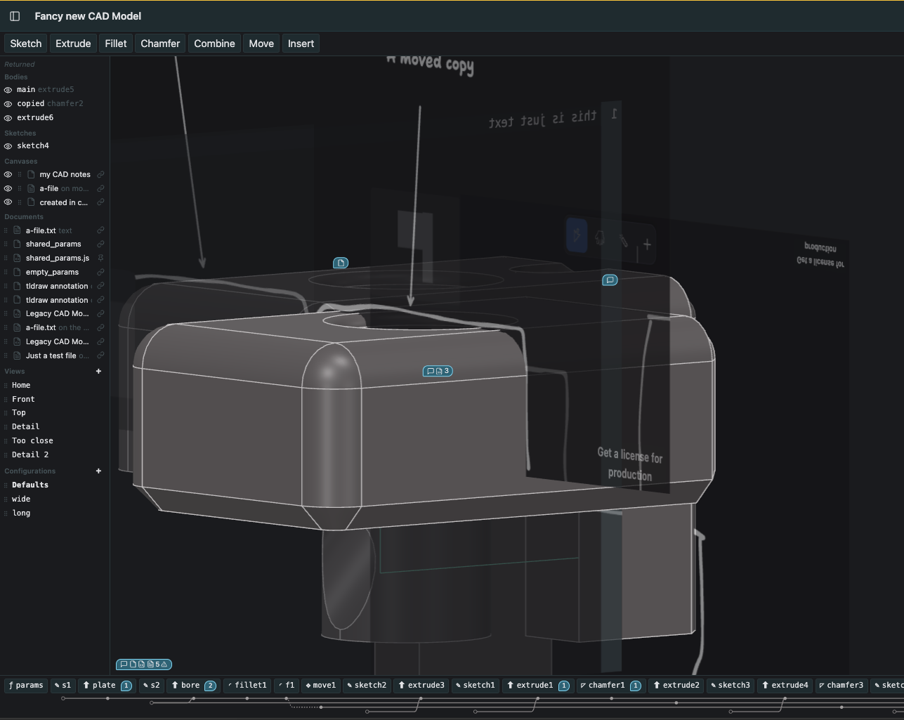

# Documents on canvases

Can a canvas ([21](21-embedding.md#canvas)) show any Patchwork document, not only an image: a tldraw drawing to trace, a markdown note next to the part, visual notes drawn onto the model? An experiment on the branch [`experiment/document-canvases`](https://github.com/iFreilicht/patchwork-cad/tree/experiment/document-canvases) shows that it can, with workarounds that Patchwork would make unnecessary. It is out of scope for now; this note keeps what was found and what [Patchwork would need](#what-patchwork-would-need).

## The experiment

A canvas of a document that isn't an image shows it live, in a `<patchwork-view>` with the document's tool, laid out 900 CSS pixels wide and placed on the plane in 3D by three's `CSS3DRenderer` ([`Viewer.tsx`][viewer], [`documentCanvases.ts`][documentCanvases]). "Canvas" is offered in "Use as" for any document but a CAD model. Tested with tldraw, a markdown document, a data document and text files, in Chromium, Firefox and WebKit ([`experiment-document-canvases.spec.ts`][spec]); the branch's last commits hold the code as it was.

- **Depth needs two WebGL canvases.** `CSS3DRenderer` puts DOM in front of or behind the WebGL canvas as a whole: "It's not possible to use the material system of three.js" ([three.js](https://threejs.org/docs/pages/CSS3DRenderer.html)). The documents lie in a layer between two canvases: the lower draws the scene, the upper draws it again after a pass that writes only the depth of the documents' rectangles, so only what is in front of a document. The page composes them, the documents with their CSS opacity and their own transparency: a tldraw drawing without its background is strokes over the model. The upper canvas has its own WebGL context and environment map, and draws what goes over everything (highlights, overlays, the ViewCube). Babylon's `HtmlMesh` uses half of this, "The HTML content is actually rendered below the canvas, but a depth mask is created by this class that writes to the depth buffer but does not write to the color buffer, effectively punching a hole in the canvas" ([htmlMesh.ts](https://github.com/BabylonJS/Babylon.js/blob/master/packages/dev/addons/src/htmlMesh/htmlMesh.ts)), and so its meshes in the scene "must be opaque" ([HtmlMesh](https://doc.babylonjs.com/addons/htmlMesh)). One canvas that fades what lies behind a document (a rectangle that multiplies colour and alpha by 1 − opacity) was right only for opaque documents: transparent parts showed the page's background in place of the model.

  

- **Read-only by a convention:** a handle at fixed heads is read-only (automerge-repo's `isReadOnly()`), and tldraw ("A history-pinned handle (url carries heads) is at fixed heads and rejects writes, so the whole tool renders read-only", [`tool.tsx`](../.claude/skills/writing-patchwork-tools/reference/patchwork-base/tldraw5/src/tool.tsx)) and CodeMirror ([`readOnly.ts`](../.claude/skills/writing-patchwork-tools/reference/patchwork-base/codemirror-base/src/vendor/automerge-codemirror/readOnly.ts)) honour it. So a canvas shows its document at its current heads, and every new version mounts the tool again; the live URL would update in place, but nothing then stops the tool from writing, e.g. on mount, and tldraw focuses itself as it mounts. The plugin contract has no viewer mode, preview or thumbnail (`ToolDescription`'s `tags` are `titlebar-tool`, `context-tool`, `frame-tool` and the like).
- **Read-only isn't chromeless:** tldraw keeps its page name, a toolbar, its zoom and its licence notice ("Get a license for production"). Since tools render into the light DOM, our stylesheet can hide tldraw's `.tlui-layout` and `.tl-background`, which leaves the shapes alone on the plane; per tool, and gone when its class names change.

  

- **What shows:** tldraw's shapes; a markdown document (`codemirror-markdown`) as its text; a data document in the `raw` tool's tree; a text or markdown file in the `file` tool as "No preview available for this file type".
- **Its dialog** has an image canvas's fields, a Height, Fit and "Edit in place"; selected, the canvas is outlined.

  

- **Fitting:** what part of a tldraw drawing shows is tldraw's camera, which the tool reads from `localStorage` (`<url>-camera`) as it mounts and writes there as it moves. The canvas keeps one for its 900-pixel layout, sets it before the tool mounts, and without one fits the drawing's shapes, read from the document's records. A document canvas has a height besides its width; "Fit" fits again; Calibrate scales the canvas and keeps the fit from following the drawing, so that its scale stays.
- **Editing in place:** "Edit in place" turns the camera face on to the canvas, beside the dialog, and lays the live document over it at its size on the screen, without a 3D transform, with its tool's UI: tldraw maps pointers by its container's box, which a CSS transform distorts. Done, Escape outside the document, closing the dialog or moving the camera ends it; tldraw's camera as it was left becomes the canvas's. The model, rendered alone into an image, lies over the document at 35 % opacity, and the pointer passes through it, to draw along the model's edges. Keys in a nested `<patchwork-view>` are its tool's: the CAD editor's undo binding leaves them alone ([`keys.ts`][keys]).

  

- **A `<patchwork-view>` that gets its document before it is connected never mounts its tool,** a Patchwork bug the experiment ran into ([`experiment-patchwork-view-detached.spec.ts`][detached], in Chromium, Firefox and WebKit). Setting `doc-url` runs the element's `attributeChangedCallback` also while it isn't connected, and for an idle element that starts loading a microtask later ("initial setup after an attribute landed on an idle element. Tear down whatever is there (no-op when idle) and re-sync against the attributes", `patchwork-view.js` in `@inkandswitch/patchwork-elements` 6.0.3). Loading asks for the document with a `patchwork:subscribe` event, dispatched from an element no provider can hear: "An unclaimed subscription is never settled: if no provider answers, `listener` simply never fires" (`subscribe` in `@inkandswitch/patchwork-providers` 0.5.3). Once connected, the element finds its view already made and doesn't start again; removed and connected anew, it mounts. The experiment set `doc-url` as it made a document's frame and connected the view a frame later, once `CSS3DRenderer` had put the frame into the page; it now sets the attributes as it connects the view, in the same task, and every view mounts. Neither three.js nor the 3D layer is involved: a view connected in the same task mounts in the `CSS3DRenderer` layer too. Elsewhere the editor's `<patchwork-view>`s are inserted as they are made.
- **Workarounds the browsers needed:**
  - `CSS3DObject` sets `pointer-events: auto` on its element, so documents above the lower canvas took the wheel into tldraw's own zoom; the frames set it to `none`.
  - Firefox measures an element in the `CSS3DRenderer` layer far too large (`getBoundingClientRect`, 70708 × 109814 pixels for a face-on frame); tldraw sizes its overlay canvas by its container's box, made one larger than allowed ("Canvas exceeds max size") and crashed into its error screen, and in Chromium it culled shapes it took to be off screen. `getBoundingClientRect` is patched for elements in a document's frame, which then measure as laid out. Frames seen edge on or reaching behind the camera are hidden.
  - In the harness, tldraw takes its undo key from the host (Cmd on macOS) while the emulated platform is Windows.
- **Not solved:** the model between two documents is drawn behind both, as the upper canvas only knows what is in front of every document, and documents lie over one another as the browser sorts them, each at its own opacity; a document seen from behind shows mirrored, chrome and licence notice included. Also editing in place on a turned canvas or a face not seen square on, and the second WebGL context, which counts against the browser's limit.

  

## Why not a texture

A texture would make all of the above unnecessary: depth, opacity and mipmapping are WebGL's. But the browser doesn't rasterize another tool's DOM:

- **SVG `<foreignObject>`** needs every stylesheet, font and image inlined, doesn't take canvases or shadow DOM along, and isn't accepted as a WebGL texture everywhere.
- **html2canvas and the like** reimplement CSS layout: heavy, approximate, and too slow for every change.
- **Screen and element capture** (`getDisplayMedia`) asks for permission, which embeds and sandboxes refuse.
- **The tool's own export,** e.g. tldraw's `editor.getSvgString()`, lives inside its tool; bundling tldraw in the CAD tool would cover one datatype at a fixed version.

A different 3D engine doesn't help either: every WebGL or WebGPU engine draws into a canvas, and Babylon's `HtmlMesh` is the same technique as the experiment's.

## What Patchwork would need

1. **A way to show a document view-only and without chrome,** e.g. an attribute of `<patchwork-view>` that tools honour: no editing UI, no focus, no writes, no input. Fixed heads give read-only today, but not chromeless, and they mount the tool again for every version.
2. **A way to get a document as an image or SVG,** from its datatype or tool, at a size and for a part of it, so that a host can texture it. That would also serve thumbnails, previews and exports elsewhere.
3. **A camera or fit contract** for tools whose documents are larger than their view: fit to the content, or show a given part, and report what is shown, instead of tldraw's `localStorage` key.
4. **Views that load once they are connected:** a `<patchwork-view>` that gets its document while detached should wait for `connectedCallback`, or start again there, instead of waiting forever for an answer no provider can give ([above](#the-experiment)).
5. **Focus and keys:** a nested view takes its own keys, and doesn't take the focus as it mounts, so that embedding it doesn't steal the host's shortcuts.

## To watch

- **HTML-in-Canvas,** a WICG proposal: "`drawable` for opting in canvas descendants to layout", "The `drawElementImage()` method draws the last snapshot of a `drawable` element", and "similar APIs are provided for WebGL and WebGPU to draw into a texture" (WebGL's `texElementSubImage2D`, [explainer](https://github.com/WICG/html-in-canvas)). A `<patchwork-view>` as a child of the 3D view's canvas could then be a texture, with any engine; a third-party site reports it in Chrome 157 by default ([html-in-canvas.dev](https://html-in-canvas.dev/docs/browser-support/)), unconfirmed, and not in Firefox.

[viewer]: https://github.com/iFreilicht/patchwork-cad/blob/experiment/document-canvases/src/cad/src/components/Viewer.tsx
[documentCanvases]: https://github.com/iFreilicht/patchwork-cad/blob/experiment/document-canvases/src/cad/src/components/documentCanvases.ts
[spec]: https://github.com/iFreilicht/patchwork-cad/blob/experiment/document-canvases/src/harness/e2e/tests/experiment-document-canvases.spec.ts
[keys]: https://github.com/iFreilicht/patchwork-cad/blob/experiment/document-canvases/src/undo/src/keys.ts
[detached]: https://github.com/iFreilicht/patchwork-cad/blob/experiment/document-canvases/src/harness/e2e/tests/experiment-patchwork-view-detached.spec.ts
